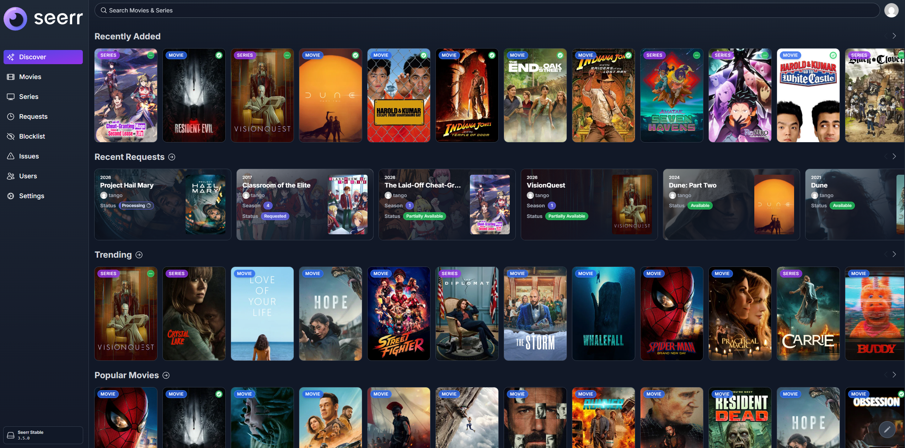
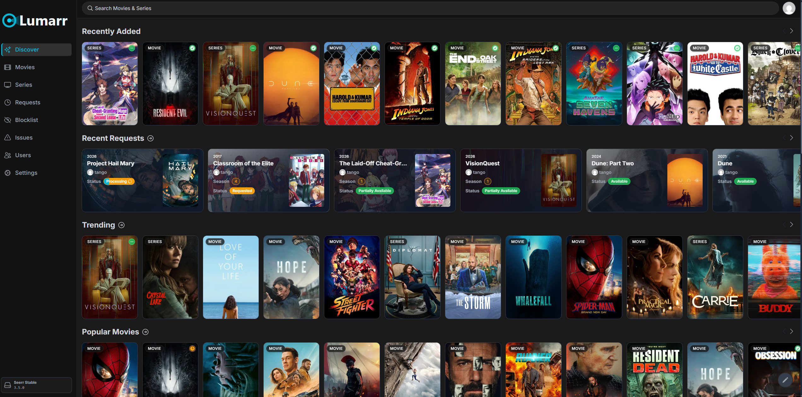
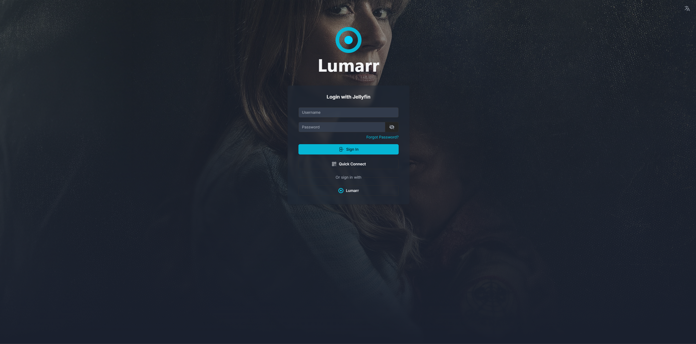
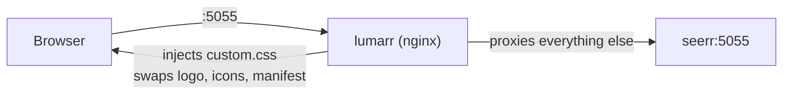

<p align="center">
  
</p>

<p align="center">
  A dark charcoal and electric cyan theme and rebrand for <a href="https://github.com/seerr-team/seerr">Seerr</a>.<br>
  No forking, no rebuilding: a tiny nginx container sits in front of Seerr and restyles it.
</p>

---

## Screenshots

| Default Seerr | Lumarr |
|---|---|
|  |  |



## What it changes

- **Colors:** flat charcoal surfaces (`#121212` sidebar, `#1A1A1A` background, `#242424` cards) with an electric cyan accent (`#06B6D4`)
- **Sidebar:** muted gray links that brighten on hover, cyan active tab with an accent edge
- **Badges:** neutral MOVIE / SERIES labels that stay readable on bright posters, solid green *Available* and amber *Requested* status pills
- **Page titles:** clean off-white instead of the purple gradient
- **Branding:** Lumarr logo in the sidebar and on the login page, plus a matching tab icon, iPhone home-screen icon and Android / PWA manifest

Every color is a CSS variable in one `:root` block at the top of `theme/custom.css`, so you can recolor the whole thing in a minute.

## How it works



nginx uses `sub_filter` to add one `<link>` to Seerr's HTML, and answers requests for Seerr's logo, favicon and manifest with Lumarr's files. Seerr itself is untouched, so updating Seerr does not undo the theme.

## Installation

Tested with **Seerr 3.5.0**. Requires Docker Compose and a running Seerr container.

### 1. Download

```bash
git clone https://github.com/Tangokrish/lumarr.git
```

You need two things from it: `nginx.conf` and the `theme/` folder. Put them next to the `docker-compose.yml` that runs Seerr, for example:

```
your-stack/
├── docker-compose.yml
├── nginx.conf
└── theme/
```

### 2. Add Lumarr to your compose file

Add the `lumarr` service, and **remove the `ports:` from Seerr** so Seerr is only reachable through the theme:

```yaml
services:
  seerr:
    image: ghcr.io/seerr-team/seerr:latest
    container_name: seerr
    # ports:            <- remove, Lumarr takes over 5055
    #   - "5055:5055"
    # ...the rest of your Seerr config stays the same

  lumarr:
    image: nginx:alpine
    container_name: lumarr
    ports:
      - "5055:80"
    volumes:
      - ./nginx.conf:/etc/nginx/conf.d/default.conf:ro
      - ./theme:/usr/share/nginx/custom:ro
    depends_on:
      - seerr
    restart: unless-stopped
```

Both containers must be on the same Docker network (they are by default if they are in the same compose file). If your Seerr container is not called `seerr`, change `proxy_pass http://seerr:5055;` in `nginx.conf`.

A full example is in [`docker-compose.example.yml`](docker-compose.example.yml).

### 3. Start it

```bash
docker compose up -d seerr lumarr
```

Open Seerr on port 5055 in a **private window** (Seerr's service worker and your browser cache the old look and icons).

### 4. Optional: rename the app

In Seerr, go to **Settings, General, Application Title** and set it to `Lumarr`. That updates the tab title, login page and notifications.

## Already using a reverse proxy?

If you run Nginx Proxy Manager, SWAG, Caddy or Traefik, you can skip the extra container. Serve the `theme/` folder somewhere and inject this into Seerr's `<head>` with your proxy's response-rewriting feature:

```html
<link rel="stylesheet" href="/custom/custom.css">
```

The location blocks in `nginx.conf` show which Seerr asset paths to override for the logo and icons.

## Customizing

| What | Where |
|---|---|
| Colors | `:root` block at the top of `theme/custom.css` |
| Sidebar logo | `theme/logo.svg` |
| Login page logo | `theme/logo_stacked.svg` |
| Tab icon | `theme/icon.svg` |
| iPhone icon | `theme/apple-touch-icon.png` (180 x 180) |
| Android / PWA name and icons | `theme/site.webmanifest`, `theme/lumarr-192.png`, `theme/lumarr-512.png` |

Changes to files in `theme/` show up on refresh. After editing `nginx.conf`, run `docker compose up -d --force-recreate lumarr` (it is a single-file mount, so a plain reload can keep reading the old file).

## Troubleshooting

- **Nothing changed:** test in a private window. Then check the injection: `curl -sL http://localhost:5055 | grep custom.css` should print a match.
- **Something is still purple:** right-click it, choose **Inspect**, find the class that sets the color, and add an override at the end of `custom.css`. Issues and pull requests with new selectors are welcome.
- **502 Bad Gateway:** nginx cannot reach Seerr. Check the container name in `proxy_pass` and that both containers share a network.

## Credits

- [Seerr](https://github.com/seerr-team/seerr) by the Seerr team. Lumarr is an unofficial theme and is not affiliated with or endorsed by the Seerr project.
- Built by [Tangokrish](https://github.com/Tangokrish) for a self-hosted homelab.

## License

[MIT](LICENSE)
